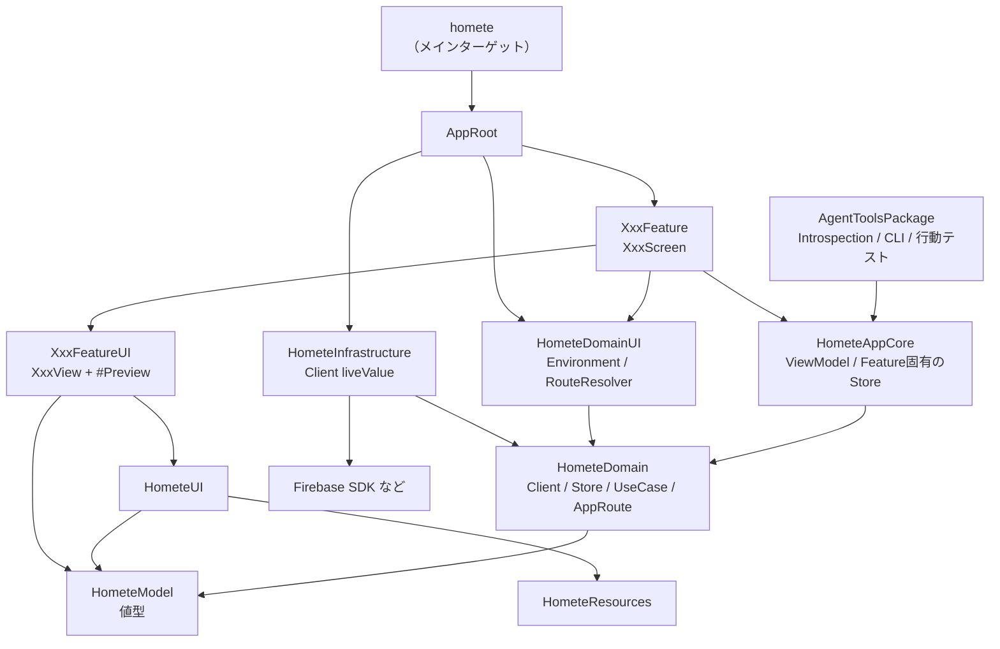

# マルチモジュール構成

> この構成を採用した背景・目的・意思決定の経緯は [ADR-0001](adr/0001-spm-multimodule-structure.md) を参照。
> `HometeInfrastructure`・`AppRoot`を`InfraPackage`に分けている経緯は [ADR-0046](adr/0046-split-infra-package-from-local-package.md) を参照。
> UIが使う値型を`HometeModel`に分け、`HometeUI`・`XxxFeatureUI`を`HometeDomain`から切り離している経緯は [ADR-0063](adr/0063-split-ui-modules-from-domain-for-affected-vrt.md) を参照。
> SwiftUIで描くモジュールを`UIPackage`に分けている経緯は [ADR-0071](adr/0071-split-ui-package.md) を参照。
> 画面単位のViewModelを`HometeAppCore`に置き、CLIと行動テストから動かしている経緯は [ADR-0072](adr/0072-app-core-view-models-and-behavior-cli.md) を参照。

## パッケージ構成

| パッケージ | 置くもの | 外部依存 |
|---|---|---|
| `LocalPackage/` | SwiftUIに依存しない`HometeModel`・`HometeDomain`・`HometeAppCore`・`HometeLocalNotification`・`HometeAppIntents`。ユニットテストはすべてここ | なし |
| `UIPackage/` | SwiftUIで描く`HometeDomainUI`・`HometeUI`・`HometeResources`・`XxxFeature`・`XxxFeatureUI`・`HometeAppIntentsUI`・`HometeSnapshotTestSupport`。iOS向けにだけビルドし、ユニットテストは置かない。`../LocalPackage`をパス依存で参照する | SwiftGenPlugin、Prefire、swift-snapshot-testing（軽いものだけ） |
| `InfraPackage/` | `HometeInfrastructure`・`AppRoot`。`../LocalPackage`・`../UIPackage`をパス依存で参照する | Firebase、AdMob、UMP、RevenueCat、GRDB |
| `AgentToolsPackage/` | `HometeIntrospection`・`HometeScenarioSupport`・`HometeCLI`（`homete-cli`）・行動テスト。ホスト（macOS）向けにだけビルドし、`../LocalPackage`だけを参照する（[doc/tech/agent-cli.md](tech/agent-cli.md)） | なし |

LocalPackage・UIPackageにFirebaseなどの重い依存を持ち込まない。ユニットテスト（`make test-packages-fast`）やUIのビルドがそれらを解決・ビルドするようになり、切り出した意味がなくなるため。重い外部SDKが必要な実装は`InfraPackage`に置く。

LocalPackageではAppleのUIフレームワーク（SwiftUI・UIKit）をimportしない。CLI・行動テスト（AgentToolsPackage）から使うため。Viewにつなぐ部分は`HometeDomainUI`に置く。

UIPackageにはユニットテストが無い。ローカルでは`make build-affected`（全体は`make build-ui-package`）でiOSシミュレータ向けにビルドして確かめる。CIではXcode CloudのVRTと`ci_infra_package.yml`がビルドする。

InfraPackageにもユニットテストが無く、`make test-packages-fast`ではビルドされない。`HometeDomain`のClientプロトコルやFeatureの公開APIを変えたら`make build-infra-package`で追従漏れを確かめる（CIでは`ci_infra_package.yml`が同じことをする）。

AgentToolsPackageの行動テストは`make test-affected`の対象にならない。`HometeAppCore`・`HometeDomain`・`HometeModel`を変えたら`make test-behavior`も流す（`make affected`が要否を出す。CIでは`ci_agent_tools.yml`が流す）。

## モジュール構成

### 各モジュールの役割

| モジュール | 役割 | 依存先 |
|---|---|---|
| `HometeModel` | UIが使う値型のドメインモデル（`HouseworkItem`・`LoginContext`・`DomainError`、Featureが表示に使う`HouseworkBoardItem`・`TemplateItemEditInput`など）。Store・UseCase・Clientは置かない | なし（最下層） |
| `HometeDomain` | UIが使わない値型（AnalyticsLog・RemoteConfigなど）・Clientプロトコル・Store・UseCase・AppRoute。`HometeModel`を再公開する。SwiftUIはimportしない | `HometeModel` |
| `HometeAppCore` | 画面単位のViewModel（`TodayHouseworkViewModel`・`HouseworkCompleteViewModel`）と、Feature固有のStore（`ContributionStore`・`PaywallStore`・`HouseworkTemplateEditStore`など）・`HouseworkListStore`の画面向けの拡張。非同期の処理を追跡する`TaskTracker`。SwiftUIはimportしない | `HometeDomain` |
| `HometeLocalNotification` | ふりかえり通知（ローカル通知・App Group の設定保存）と、メンテナンス中かどうかの共有（`MaintenanceStateClient`、[ADR-0055](adr/0055-maintenance-mode-with-remote-config.md)）の liveValue 実装。Notification Service Extension からも使うため Firebase に依存させない（[ADR-0021](adr/0021-daily-completion-reminder-on-device.md)） | `HometeDomain` |
| `HometeAppIntents` | Siri・Spotlight・ショートカットAppから実行するApp Intent・Entity。Firebase の実装はアプリから`AppDependencyManager`経由で受け取るため`HometeInfrastructure`に依存させない（[ADR-0044](adr/0044-app-intents-headless-usecase-and-title-keyed-entity.md)） | `HometeDomain`, `HometeAppCore` |
| `HometeDomainUI`（UIPackage） | `HometeDomain`をSwiftUIにつなぐ部分。`\.appDependencies`などのEnvironmentへの登録・`DependenciesInjectLayer`・`RouteResolver`・`.trackScreenView` | `HometeDomain` |
| `HometeResources`（UIPackage） | アセット（色・画像）・SwiftGen 生成コード | なし |
| `HometeUI`（UIPackage） | デザインシステム・共通コンポーネント・View ユーティリティ・表示に使うEnvironment（`\.now`・`\.houseworkStoragePolicy`）・プレビュー用の環境の設定。Store・Client・Analyticsには依存させない | `HometeModel`, `HometeResources` |
| `XxxFeatureUI`（UIPackage） | UIのみのView（`XxxView` / `XxxContent`）とプレビュー。`HometeDomain`には依存させない | `HometeModel`, `HometeUI`, `HometeResources`、必要なら他の`YyyFeatureUI` |
| `XxxFeature`（UIPackage） | ロジックを持つView（`XxxScreen` / `XxxComponent`）。Environmentから依存を集めてUIのみのViewへ渡し、シート・遷移・Storeの呼び出しを受け持つ。ViewModelにした画面は状態を読んで`send(_:)`するだけにする | `XxxFeatureUI`, `HometeDomain`, `HometeAppCore`, `HometeDomainUI`, `HometeUI`, `HometeResources` |
| `HometeAppIntentsUI`（UIPackage） | Siriの結果をSwiftUIで描くApp Intent（`ShowContributionSummaryIntent`）と、ドネーションの liveValue | `HometeAppIntents`, `HometeDomain`, `ContributionFeatureUI` |
| `HometeSnapshotTestSupport`（UIPackage） | VRT（`hometeSnapshotTests`）が使う SnapshotTesting・Prefire を提供する。アプリ本体からは依存しない | Prefire, swift-snapshot-testing |
| `HometeInfrastructure`（InfraPackage） | Client liveValue 実装・Services（Firestore / Storage / SignInWithApple）・端末内SQLite（[ADR-0031](adr/0031-housework-entry-history-in-sqlite.md)）・Firebase 依存 | `HometeDomain`, Firebase SDK, GRDB |
| `AppRoot`（InfraPackage） | RootView・AppTabView・依存の注入（`HometeDomainUI`の`DependenciesInjectLayer`を使う）・RouteResolverInjection | `HometeDomain`, `HometeAppCore`, `HometeDomainUI`, `HometeUI`, 全 Feature, `HometeInfrastructure`, `HometeLocalNotification`, `HometeAppIntents`, `HometeAppIntentsUI` |
| `HometeIntrospection`（AgentToolsPackage） | ViewModelの今の画面・状態・実行できる操作をJSONにし、JSONの操作をViewModelの`send(_:)`へ渡す | `HometeAppCore`, `HometeDomain` |
| `HometeScenarioSupport`（AgentToolsPackage） | シナリオごとの保存先のfixture（`FixtureHouseworkBackend`）と`Scenario` | `HometeIntrospection`, `HometeAppCore`, `HometeDomain` |
| `HometeCLI`（AgentToolsPackage） | `homete-cli`。標準入力のコマンドを受け、標準出力へJSONを返す | `HometeIntrospection`, `HometeScenarioSupport` |
| `homete`（メインターゲット） | アプリエントリーポイント（`HometeApp.swift`）・App Shortcuts（`AppShortcutsProvider`はアプリ本体に置く必要がある） | `AppRoot`, `HometeInfrastructure`, `HometeAppIntents`, `HometeAppIntentsUI` |
| `hometeNotificationService`（拡張ターゲット） | 古いアプリから届く家事の完了通知を受けて、今日のふりかえり通知を予約する Notification Service Extension（メンテナンス中は予約しない） | `HometeLocalNotification` |

Featureは、Auth（認証・オンボーディング）・Home（ホーム・お知らせ・招待リンクからのグループ参加）・Housework（家事ボード・登録・詳細）・HouseworkTemplate（家事テンプレート）・
Contribution（がんばりの集計）・FrequentHousework（いつもの家事。[ADR-0020](adr/0020-frequent-housework-as-independent-copy-source.md)）・Setting（設定・問い合わせ）・
CohabitantRegistration（P2P（Multipeer Connectivity）での同居人登録）・Paywall（プレミアムプランのPaywall。[ADR-0070](adr/0070-custom-paywall-view.md)）の9つ。それぞれ`XxxFeature`と`XxxFeatureUI`の組になっている。

外部ライブラリは `UIPackage/Package.swift`・`InfraPackage/Package.swift` からだけ参照し、xcodeproj から直接参照しない。xcodeproj 側にもバージョン指定を持つと、dependabot が `Package.swift` だけを更新したときに指定が食い違い、Xcode Cloud の依存解決が失敗するため。アプリ本体・拡張・テストのターゲットで外部ライブラリが必要になったら、UIPackage・InfraPackage のモジュール経由で使う。

ただし、xcodeproj でビルドするときに使われる `Package.resolved` はルート（xcodeproj）側の1つだけで、InfraPackage・UIPackage 側の `Package.resolved` は読まれない。両者の版は `scripts/sync-package-resolved.py` でそろえ、dependabot の PR では `sync-package-resolved.yml` が自動でそろえる（[ADR-0053](adr/0053-sync-xcodeproj-package-resolved-on-dependabot-prs.md)）。

### ディレクトリ構成

```
LocalPackage/Sources/
  ├── HometeModel/          UIが使う値型（Featureが表示に使う値型はFeature名のフォルダ）・プレビュー/テスト用データ（Utilities/DebugHelper）
  ├── HometeDomain/         UIが使わない値型・Client Protocols + previewValue・Stores・UseCase・AppRoute
  ├── HometeAppCore/        画面単位のViewModel・Feature固有のStore・TaskTracker
  ├── HometeLocalNotification/
  └── HometeAppIntents/     Intent（AppIntent）/ Entity / Service（App Intentsに依存しない判定）/ HometeAppIntentsConfigurator

UIPackage/Sources/
  ├── HometeDomainUI/       Environmentへの登録・DependenciesInjectLayer・RouteResolver・trackScreenView
  ├── HometeResources/      Assets（Colors.xcassets, Image.xcassets）+ SwiftGen 生成コード
  ├── HometeUI/             DesignSystem・共通コンポーネント・ViewUtilities
  ├── HometeAppIntentsUI/   ShowContributionSummaryIntent・IntentDonationClient.liveValue
  ├── HometeSnapshotTestSupport/
  └── Features/
        ├── XxxFeature/     XxxScreen / XxxComponent・Route enum
        └── XxxFeatureUI/   XxxView / XxxContent + #Preview

InfraPackage/Sources/
  ├── HometeInfrastructure/ Client liveValue 実装・Services・Storage・LocalDatabase・AppDependencies+liveValue
  └── AppRoot/              RootView / AppTabView / LaunchScreenView・RouteResolverInjection

AgentToolsPackage/
  ├── Sources/HometeIntrospection/ AppIntrospector・AppSnapshot・AgentSession
  ├── Sources/HometeScenarioSupport/ Scenario・FixtureHouseworkBackend
  ├── Sources/HometeCLI/    homete-cli
  └── Tests/HometeBehaviorTests/

homete（メインターゲット）/
  ├── HometeApp.swift（アプリエントリーポイント）
  └── AppIntents/HometeAppShortcuts.swift（AppShortcutsProvider・AppIntentsPackage）

hometeNotificationService（拡張ターゲット）/
  └── NotificationService.swift（古いアプリからの完了通知の受信時にふりかえり通知を予約）
```

## モジュール間の依存関係



> **ルール:**
> - 重い外部ライブラリ（Firebase など）への依存は `InfraPackage` のみが持つ。Feature モジュールは外部ライブラリに直接依存しない
> - `HometeInfrastructure` が Client の `liveValue` を実装し、`AppRoot` の `DependenciesInjectLayer` が Environment 経由で各 Feature に DI する
> - `HometeUI`・`XxxFeatureUI` は `HometeDomain` に依存させない。Store・Client・`routeResolver`・Analyticsが要るViewは `XxxFeature`（または `AppRoot`）側に置き、UIのみのViewには値とクロージャを渡す
> - プレビューは `HometeUI` と `XxxFeatureUI` にだけ置く
> - LocalPackage（`HometeModel`・`HometeDomain`・`HometeAppCore`）は SwiftUI・UIKit・外部SDKに依存させない。CLI（AgentToolsPackage）は UIPackage・InfraPackage に依存させない
> - Feature モジュール間の直接依存は原則禁止（`HomeFeature`は今日の家事・がんばりの部品を使うため`HouseworkFeature`・`ContributionFeature`に依存する）。Feature 間の画面遷移は RouteResolver パターンを使用する
> - Feature 内部の画面遷移は RouteResolver を使用しない。Feature 専用のルート enum を定義して管理する

## 新しいFeatureを足す手順

1. `UIPackage/Sources/Features/XxxFeatureUI/` と `XxxFeature/` を作り、それぞれに `Localizable.xcstrings` を置く
2. `UIPackage/Package.swift` に `featureUI(name: "XxxFeatureUI")`・`feature(name: "XxxFeature")` とプロダクトを足す（`feature`は同じ名前の`XxxFeatureUI`に自動で依存する）
3. `InfraPackage/Package.swift` の `AppRoot` の依存に `uiPackage("XxxFeature")` を足す
4. VRTの対象にするため、次の3か所をそろえる
   - `.prefire.yml` の `testable_imports` に `XxxFeatureUI`
   - `hometeVRT.xcodeproj` のテストターゲット（`hometeSnapshotTests`）のFrameworksに `XxxFeatureUI`
   - `scripts/affected-modules.py` の `VRT_MODULES` に `XxxFeatureUI`
5. 画面の状態と操作は`HometeAppCore`に`XxxViewModel`として置き、`LocalPackage/Tests/HometeAppCoreTests/`でテストする。UIPackageにはテストを置かない。UIが使う値型は`HometeModel`に置いて`HometeModelTests`でテストする
6. CLI・行動テストから動かすなら、[doc/tech/agent-cli.md](tech/agent-cli.md)の「画面・操作・シナリオを足す」に従ってIntrospectionに画面と操作を足す
7. このドキュメントの「モジュール」の表を更新する

## Feature 間の画面遷移（RouteResolver パターン）

Feature モジュール間で直接依存せずに画面遷移を実現するため、`HometeDomain` に `AppRoute` enum を、`HometeDomainUI` に `RouteResolver` を定義し、`AppRoot` で実態を DI する。

### 使用する場面・しない場面

| 遷移の種類 | 方法 | 例 |
|---|---|---|
| **Feature 間**（別モジュールへの遷移） | `RouteResolver` + `AppRoute` を使用 | `HomeFeature` → `SettingFeature` |
| **Feature 内**（同一モジュール内の遷移） | Feature 専用のルート enum を定義 | `HouseworkFeature` 内の詳細画面遷移 |

`AppRoute` は Feature 間遷移のみを定義する。Feature 内部の画面を `AppRoute` に追加してはいけない。Feature 内の NavigationStack の遷移管理は、各 Feature が独自のルート enum（例: `HouseworkBoardRoute`）と `AppNavigationPath<RouteType>` を使って行う。

### HometeDomain 側（Feature 間ルートのみ）

```swift
// Feature 間遷移のみを定義する
enum AppRoute: Hashable {
    case cohabitantRegistration  // HomeFeature → AuthFeature
    case setting                 // HomeFeature → SettingFeature
}
```

```swift
// HometeDomainUI 側
struct RouteResolver: Sendable {
    private var _resolve: @MainActor @Sendable (AppRoute) -> AnyView

    public init<V: View>(@ViewBuilder resolve: @escaping @MainActor @Sendable (AppRoute) -> V) {
        _resolve = { AnyView(resolve($0)) }
    }

    @MainActor
    public func resolve(_ route: AppRoute) -> some View {
        _resolve(route)
    }
}

extension EnvironmentValues {
    @Entry var routeResolver: RouteResolver = .preview
}
```

### Feature 側（使用例）

```swift
// Feature 間遷移には RouteResolver を使用する
struct HomeView: View {
    @Environment(\.routeResolver) private var router

    var body: some View {
        // ...
        .sheet(isPresented: $isShowSetting) {
            router.resolve(.setting)  // SettingFeature への遷移
        }
        .fullScreenCover(isPresented: $isShowCohabitantRegistration) {
            router.resolve(.cohabitantRegistration)  // AuthFeature への遷移
        }
    }
}

// Feature 内遷移には Feature 専用のルート enum を使用する
enum HouseworkBoardRoute: Hashable {
    case houseworkDetail(HouseworkItem)  // HouseworkFeature 内の遷移
}

extension EnvironmentValues {
    @Entry var houseworkBoardNavigationPath = AppNavigationPath<HouseworkBoardRoute>()
}

struct HouseworkBoardView: View {
    @State var navigationPath = AppNavigationPath<HouseworkBoardRoute>()

    var body: some View {
        NavigationStack(path: $navigationPath.path) {
            // ...
            .navigationDestination(for: HouseworkBoardRoute.self) { route in
                switch route {
                case .houseworkDetail(let item):
                    HouseworkDetailView(item: item)
                }
            }
            .environment(\.houseworkBoardNavigationPath, navigationPath)
        }
    }
}
```

### メインターゲット側（解決実態）

```swift
// AppRoute の各 case に対応する View をメインターゲットで解決する
private struct RouteResolverInjectionModifier: ViewModifier {
    func body(content: Content) -> some View {
        content
            .environment(\.routeResolver, RouteResolver { route in
                switch route {
                case .cohabitantRegistration:
                    CohabitantRegistrationView()
                case .setting:
                    SettingView()
                case .houseworkApproval(let item):
                    HouseworkApprovalView(item: item)
                }
            })
    }
}
```

## Store の配置方針

Store は `HometeDomain` に配置する。理由:

- Store は特定の画面に依存しない、全画面で再利用可能なビジネスルール・ドメインモデルを提供するオブジェクト
- 複数 Feature から共有される（例: `HouseworkListStore` は `HouseworkBoardView`、`HomeView` 等で利用）
- Client Protocol に依存するが、これも `HometeDomain` 内にあるため整合性が取れる
- メインターゲットで Store を初期化し、Environment 経由で各 Feature に注入

## UseCase の配置方針

> この層を採用した背景・意思決定の経緯は [ADR-0003](adr/0003-usecase-layer.md) を参照。

複数の Store・ドメインモデル・Client を合成するオーケストレーションロジックは、`HometeDomain` の `UseCase` に配置する。

- Store は単一ドメインの状態管理という責務に留め、Store 同士が直接依存し合うことは禁止のまま
- 複数 Store を跨ぐ処理が必要な場合のみ UseCase を新設する。単一 Store で完結する処理は View から直接 Store を呼び出す
- 命名は `〇〇UseCase` とし、メソッド名は用途が分かる名前にする（`execute` のような汎用名は避ける）
- メインターゲット（または `AppRoot`）で必要な Store を組み立てて UseCase に注入し、View には UseCase を渡す

## ViewModel・Feature固有のStoreの配置方針

> この層を採用した背景・意思決定の経緯は [ADR-0072](adr/0072-app-core-view-models-and-behavior-cli.md) を参照。

画面ごとの状態（入力中の値・処理中・エラー・シートの表示・閉じる判断）は、`HometeAppCore` の `XxxViewModel` に置く。
1つの画面でしか使わないStore（`ContributionStore`・`PaywallStore`・`HouseworkTemplateEditStore`）も `HometeAppCore` に置く。

- UIからは`state`を読み、操作は`send(Action)`で送る。状態の変更は`update(Message)`に集め、非同期の結果も`Message`で戻す
- 共有データの正はStore。ViewModelの状態はStoreから作る表示用の写しにし、別の一覧を独立して書き換えない
- 操作の制約（処理中の再要求など）もViewModelで判断し、ボタンの非活性だけに頼らない
- シートを出すかは親のViewModelが持つ。SwiftUIの`.sheet(item:)`のBindingのgetterで読み、下へのスワイプで閉じたらsetterからActionを送る
- エラーは意味を表す型（`DomainError`など）で持ち、文言はUI側で決める
- 非同期の処理は`TaskTracker`から始める（CLI・テストが完了を待てるように）。閉じた画面に後から届く結果は捨てる
- ViewModelは必要なStoreを受け取って業務処理を任せてよい（Store間の依存ではなく、AppCoreからDomainを使う経路）

## 補足・制約事項

- **ProjectTools**（SwiftLint / Danger）は現行のローカルパッケージ形式のまま変更不要
- **Firebase iOS SDK** 等のサードパーティ依存は `InfraPackage` の `HometeInfrastructure` が保持する
- **Swift 6 strict concurrency** との整合性（actor 分離、Sendable 等）は各 Phase で確認する
- **Feature 間の循環依存**を防ぐため、Feature 間の画面遷移は必ず RouteResolver パターンを使用する
